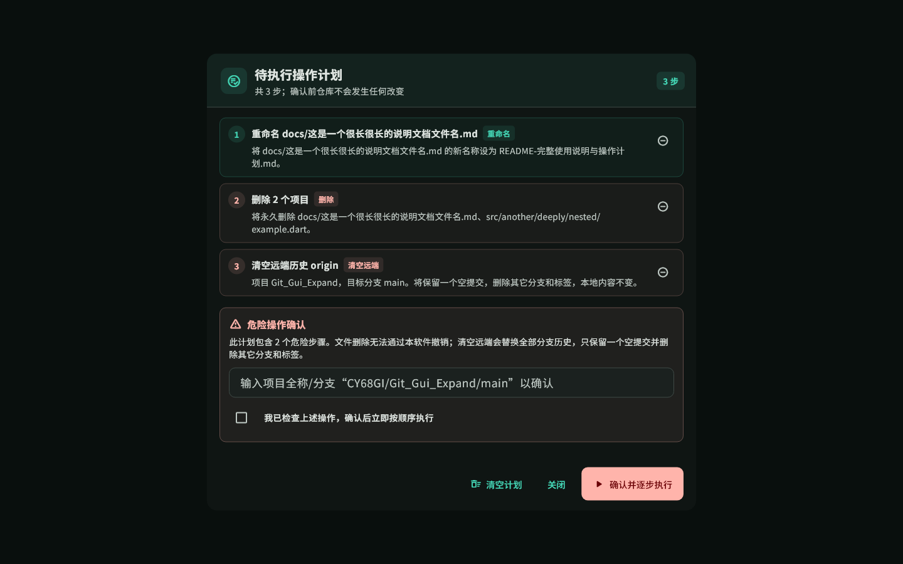
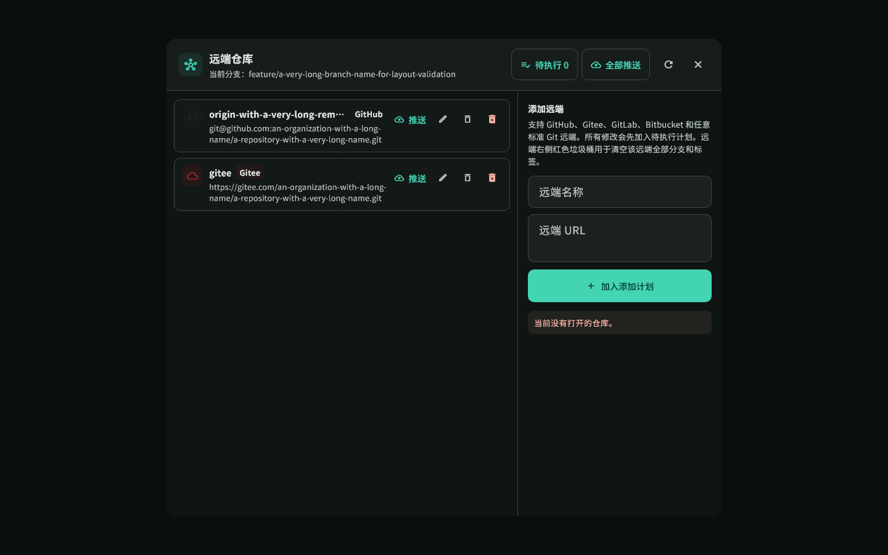
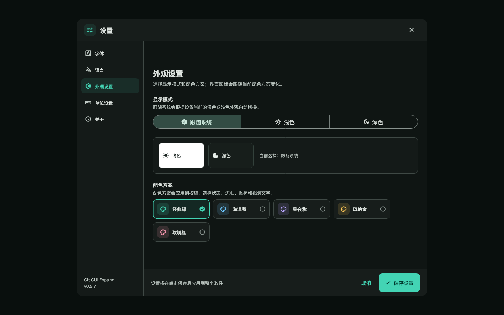

# Git GUI Expand


[English](README.md) | [简体中文](README.zh-CN.md) | 繁體中文

[](https://github.com/CY68GI/Git_Gui_Expand/actions/workflows/windows-release.yml)


## 軟體截圖

| 主頁面 | 操作計畫 |
| --- | --- |
|  |  |

| 遠端管理 | 外觀設定 |
| --- | --- |
|  |  |

Git GUI Expand 是一套以 Windows 為優先的 Flutter 桌面應用程式，透過左右雙欄
檔案工作區操作已初始化的 Git 儲存庫。檔案與版本控制變更都交由本機 Git CLI
執行，軟體提供可視化操作，不會自行取代 Git。

目前版本：`0.10.0`

- GitHub：<https://github.com/CY68GI/Git_Gui_Expand>
- Gitee：<https://gitee.com/CY68EWZRY/Git_Gui_Expand>

## 主要功能

- 使用 Windows 標準「開啟」對話框開啟儲存庫。
- 可開啟空白資料夾，並詢問是否立即執行 `git init`。
- 可從 HTTPS、SSH 或本機 Git 網址複製儲存庫。
- 對沒有設定任何遠端的儲存庫，可清除 `.git` 中繼資料；工作檔案保留，
  軟體會明確說明歷史、分支和索引將永久遺失。
- 從最近開啟記錄快速重新開啟已驗證的 Git 儲存庫。
- 左右資源面板可獨立瀏覽同一個儲存庫。
- 使用核取方塊選取檔案與資料夾，支援批次操作。
- 透過 Git 執行剪下、複製、貼上、重新命名、移動與刪除。
- 所有會修改儲存庫的操作先進入待執行計畫，確認後才逐步執行。
- 執行前重新檢查儲存庫、路徑和遠端狀態；狀態變更時停止計畫、顯示漂移詳情並提供復原入口。
- 提交前檢查有效 Git 作者與提交者身分，執行時再次複核，避免身分缺失造成部分執行。
- 支援暫存、取消暫存、提交、推送與多平台遠端管理。
- 可檢視 upstream、ahead/behind，並透過執行計畫取得目前 upstream 或全部遠端。
- 安全 Pull 僅允許乾淨、未分叉的落後分支，透過 Fetch 後執行 `git merge --ff-only`。
- 可建立、切換、重新命名和刪除本機分支，分支操作同樣先進入執行計畫。
- 可建立、檢視、套用、彈出和刪除 Git Stash，並支援包含未追蹤檔案。
- 可管理 GitHub、Gitee、GitLab、Bitbucket 與一般 Git 遠端。
- 輸入「遠端擁有者/專案/分支」確認後，可用原子空根提交清除指定遠端歷史。
- 可在檔案總管中定位檔案，或使用系統預設應用程式開啟。
- 顯示專案大小、檔案大小、目前分支、Git 狀態與待提交變更。
- 支援 IEC/SI 大小單位與 Byte/bit 基礎單位。
- 支援跟隨系統、淺色與深色顯示模式，並提供五種配色方案。
- 可搜尋內建與系統 UI 字型，字級限制為 90%、100%、110%。
- 支援 English、简体中文、繁體中文，預設跟隨作業系統語言。
- 普通日誌與詳細日誌依目前介面語言產生。
- 可在「設定 → 關於」一鍵建立桌面捷徑。
- 可在「設定 → 關於」查看 `git_gui_expand` 和 `GitGuiExpandLauncher` 的實際檔案版本。
- 可在「設定 → 關於」掃描舊版本與安裝包，並一鍵清除。
- 使用穩定 Launcher、獨立版本目錄、啟動健康檢查與自動回滾完成更新。
- 更新成功後只保留目前版本，並清除其他版本、更新 ZIP 和臨時解壓目錄。

## Git 功能覆蓋

圖例：`✅` 已在軟體中實現，`❌` 目前未實現。

| Git 功能 | 狀態 | 說明 |
| --- | --- | --- |
| 開啟已初始化儲存庫 | ✅ | Windows 標準選擇器與最近儲存庫記錄 |
| `git init` 初始化儲存庫 | ✅ | 一次性預覽、目標複核和明確確認 |
| `git clone` 複製儲存庫 | ✅ | 預覽視窗、目標複核和明確確認 |
| 清除 Git 中繼資料（`.git`） | ✅ | 作為獨立計畫步驟；僅在未設定遠端時允許，工作檔案保留 |
| `git status` 狀態 | ✅ | 顯示分支、暫存、未暫存和未追蹤狀態 |
| 列出已追蹤和未追蹤檔案 | ✅ | 遵循 `.gitignore` |
| 選擇性暫存 / 按區塊暫存 | ❌ | 目前只能全部暫存或全部取消 |
| `git add -A` 暫存全部 | ✅ | 先加入執行計畫並確認 |
| 取消暫存全部 | ✅ | 保留工作區檔案內容 |
| `git commit` 提交全部變更 | ✅ | 必須填寫說明並確認執行 |
| amend、sign-off、GPG 簽章提交 | ❌ | 未實現 |
| Diff 檢視器 / 區塊編輯器 | ❌ | 僅顯示檔案狀態 |
| `git mv` 重新命名和移動 | ✅ | 支援檔案與資料夾 |
| 透過 Git 物件與索引複製 | ✅ | Git 沒有原生 `git cp` |
| `git rm` / `git clean` 刪除 | ✅ | 需要危險操作確認 |
| 顯示目前分支 | ✅ | 在提交工作區顯示 |
| 建立、切換、重新命名、刪除分支 | ✅ | 本機操作先進入執行計畫 |
| Merge、rebase、cherry-pick | ❌ | 未實現 |
| Reset、revert、restore 介面 | ❌ | 內部 reset 僅供清除遠端歷史使用 |
| `git stash` | ✅ | 支援建立、套用、彈出、刪除和包含未追蹤檔案 |
| 建立、刪除、推送標籤 | ❌ | Release 標籤由外部工具管理 |
| Git 日誌、分支圖、blame、reflog | ❌ | 軟體操作日誌不是 Git 歷史 |
| Git grep / bisect | ❌ | 未實現 |
| 衝突編輯器 | ❌ | 未實現 |
| 檢視、新增、修改、刪除遠端 | ✅ | 支援多平台遠端 |
| 推送目前分支 | ✅ | 支援單一或全部遠端並設定 upstream |
| Fetch | ✅ | 目前 upstream/全部遠端 Fetch 先進入計畫；部分失敗時保留成功更新 |
| Pull | ✅ | 僅限乾淨且已追蹤的落後分支；Fetch 後 `git merge --ff-only`，分叉時拒絕 |
| 清除遠端歷史 | ✅ | 強確認後以空根提交原子替換 |
| SSH/HTTPS 認證 | ✅ | 由系統 Git 憑證機制處理 |
| 子模組、worktree、sparse checkout | ❌ | 未實現 |
| Git LFS | ❌ | 未實現 |
| Hooks 編輯器 | ❌ | 未實現 |
| Archive / bundle / fsck / gc 介面 | ❌ | 未實現 |

## 環境需求

- Windows 10 或 Windows 11
- Git 2.40 以上
- 原始碼建置需要 Flutter 3.47.x、Dart 3.13.x
- 需要 Visual Studio「使用 C++ 的桌面開發」工作負載

Linux 與 macOS 目錄目前僅作預留，尚未建置或驗證。

## 下載選擇

請從 [GitHub Releases](https://github.com/CY68GI/Git_Gui_Expand/releases)
或 [Gitee Releases](https://gitee.com/CY68EWZRY/Git_Gui_Expand/releases) 下載。

1. `Git_Gui_Expand-<tag>-windows-x64.zip`：建議使用的標準套件，需要自行從
   <https://git-scm.com/download/win> 安裝 Git。軟體一律優先使用系統中有效的 Git。
2. `Git_Gui_Expand-<tag>-windows-x64-PortableGit.zip`：包含固定版本
   PortableGit，適合無法另外安裝 Git 的電腦。
3. `PortableGit-<版本>-64-bit-runtime.zip`：獨立的 PortableGit 執行環境更新套件。

建議使用標準套件，讓系統 Git、SSH 與認證管理員依原本方式維護。
PortableGit 套件可在「設定 → Git」中將穩定的
`runtime/git/current/cmd` 加入目前使用者或系統 `PATH`。每次修改前都會備份，
而且只會移除軟體管理的那個項目。

## 建置與測試

```powershell
flutter pub get
flutter analyze
flutter test
flutter build windows --release
```

Flutter 建置輸出：

```text
build\windows\x64\runner\Release\
```

建立發布 ZIP：

```powershell
.\tool\package_windows_release.ps1 -Tag v0.10.0
```

## 發布目錄結構

```text
Git GUI Expand/
  GitGuiExpandLauncher.exe
  current-version.txt
  versions/
    0.10.0/
      maintenance/
        GitGuiExpandLauncher.exe
      git_gui_expand.exe
      flutter_windows.dll
      data/
      version.json
  userdata/
    settings.json
    recent_repositories.json
    logs/
    updates/
```

請一律透過 `GitGuiExpandLauncher.exe` 啟動。Launcher 會驗證版本資訊與程式檔案；
若 `current-version.txt` 缺失，會從唯一有效的 `versions/<版本>` 自動恢復，也支援
根目錄直接放置 `git_gui_expand.exe` 與 `data` 的開發或相容目錄。

所有設定、日誌、最近開啟記錄與更新資料都保存在軟體目錄的 `userdata`。
軟體目錄必須可寫入。

## 操作安全

檔案移動、複製、重新命名、刪除、提交、推送、遠端設定與清除遠端歷史都會先加入
待執行計畫。執行前會重新檢查儲存庫、分支、HEAD、狀態、路徑、初始化/複製目標與
遠端引用；危險操作需要明確勾選確認。清除遠端歷史會比較每個引用和物件雜湊，並以
atomic push 加逐引用 `--force-with-lease` 執行，還必須準確輸入
`遠端擁有者/專案/分支`。

## 自動更新與版本保留

更新頁面可選擇 GitHub 或 Gitee Release；中國大陸網路建議使用 Gitee。
新版 Release 不再上傳個別 `.sha256` 檔案，更新器會從 GitHub Release
資產中繼資料讀取 SHA-256。使用 Gitee 鏡像下載時，會按相同標籤和相同資產名稱
比對 GitHub 摘要。無法取得可信摘要時會停用自動安裝，並保留「開啟發布頁」。

Launcher 會下載並驗證 Windows x64 ZIP，解壓縮到獨立版本目錄，應用程式結束後
切換版本。新版本未通過啟動檢查時會自動回滾。

更新成功後只保留目前版本，其他舊版本目錄和更新下載包會刪除。設定、日誌、
最近開啟記錄與其他 `userdata` 檔案由所有版本共用。

應用程式啟動時也會主動執行清理。由於舊 Launcher 無法自行更新，發布包會在版本
目錄攜帶維護用 Launcher；目前應用程式結束後，維護助手會重試覆蓋根目錄
`GitGuiExpandLauncher.exe`，確保後續啟動使用新版 Launcher。

PortableGit 會獨立保存在 `runtime/git/versions/PortableGit-<版本>-64-bit`，
`runtime/git/current.json` 記錄目前與上一個執行環境。授權、第三方聲明與原始碼取得
說明請見 [PortableGit 說明](docs/PORTABLEGIT.md)。

## 文件

- [English User Guide](docs/USER_GUIDE.md)
- [简体中文使用指南](docs/USER_GUIDE.zh-CN.md)
- [繁體中文使用指南](docs/USER_GUIDE.zh-TW.md)
- [架構說明](docs/ARCHITECTURE.md)
- [互動說明](docs/UX.md)

## 致謝

感謝 DeepSeek 人工智慧和 ChatGPT Codex，兩者合力建立、編寫、修改此專案。

## 授權

本專案使用 [MIT License](LICENSE)。
