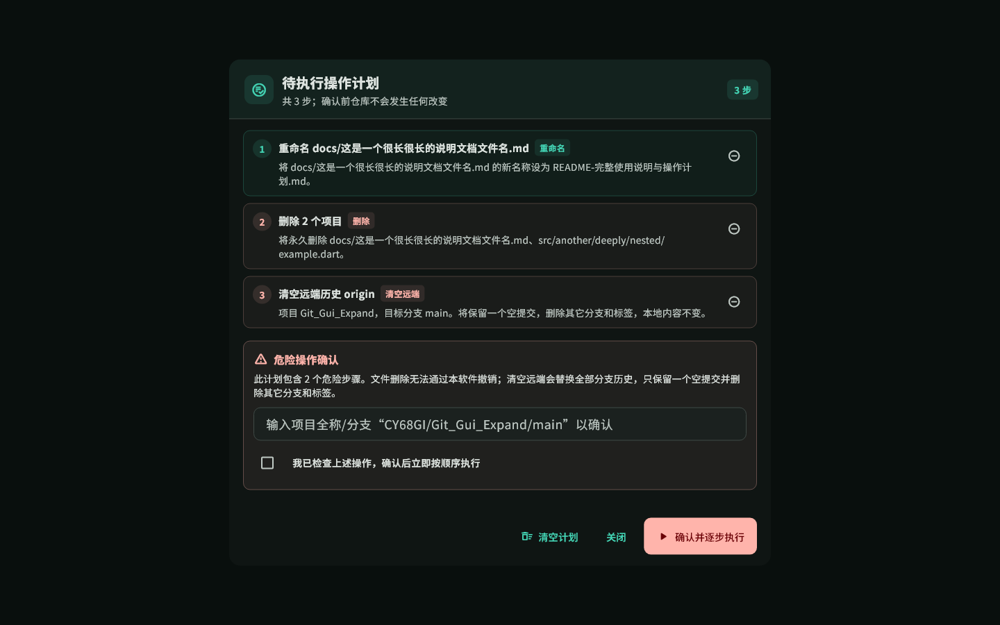

# Markdown Guide Authoring

Git GUI Expand parses bundled guides with `package:markdown` and renders the
resulting AST as Flutter widgets. Raw HTML is never interpreted as executable
content.

## Add or replace a guide

The approved guide assets are:

| Language | Asset |
| --- | --- |
| English | `docs/USER_GUIDE.md` |
| Simplified Chinese | `docs/USER_GUIDE.zh-CN.md` |
| Traditional Chinese | `docs/USER_GUIDE.zh-TW.md` |

Update the corresponding file and keep the three guides structurally
equivalent. `GuideAssets` exposes these paths to tests and the dialog.

## Add a heading anchor

Headings receive stable anchors derived from their visible text:

```markdown
## 4. Commit workspace

[Return to planning](#1-plan-before-execution)
```

Duplicate headings receive numeric suffixes. Chinese headings are retained in
their slug rather than transliterated.

## Add a local image

Store images under `docs/images/` and use a path relative to the guide:

```markdown

```

Only image paths that resolve beneath `docs/` and use a supported image
extension are loaded. Parent traversal, absolute paths, local-file schemes, and
remote images are rejected.

## Add a link

Approved link forms are:

```markdown
[Project repository](https://github.com/CY68GI/Git_Gui_Expand)
[Simplified guide](USER_GUIDE.zh-CN.md)
[Commit workspace](#4-commit-workspace)
```

HTTPS links use the shared external-link service. Relative links can switch
only among the approved bundled guide assets. `javascript:`, `data:`, `file:`,
arbitrary local paths, raw HTML, and unsupported schemes remain inert.

## Supported structure

The renderer covers headings, paragraphs, emphasis, strong text,
strikethrough, inline code, fenced code blocks, ordered and unordered nested
lists, block quotes, tables, horizontal rules, selected local images, and safe
links. Code blocks and wide tables scroll horizontally.

Run these checks after editing a guide:

```powershell
flutter test test/markdown_parser_test.dart test/markdown_render_test.dart
flutter analyze
```
