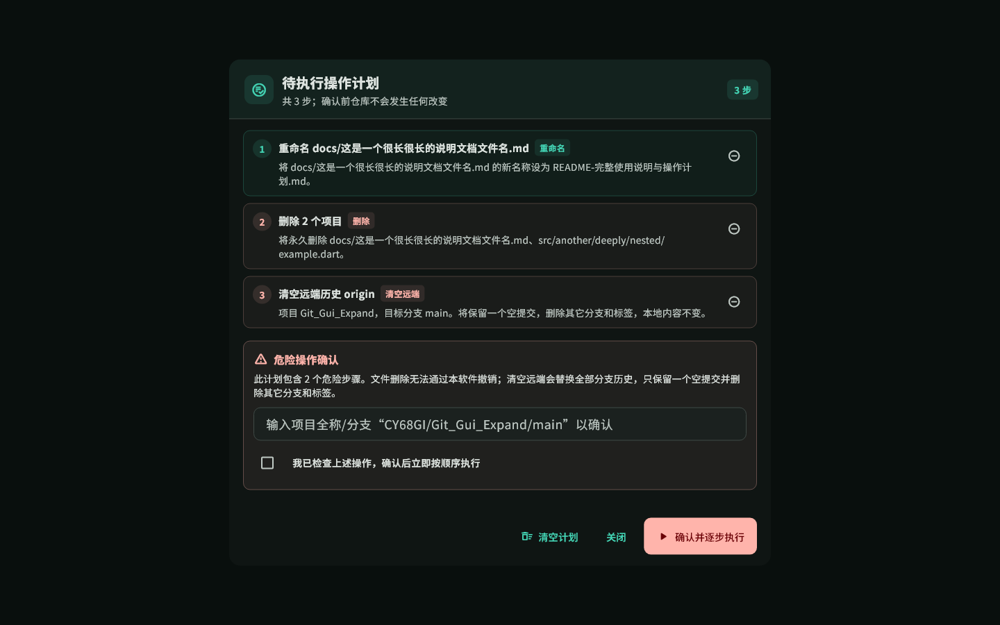

# Git GUI Expand User Guide

Languages: English | [简体中文](USER_GUIDE.zh-CN.md) | [繁體中文](USER_GUIDE.zh-TW.md)

> The guide is rendered as formatted Markdown. Links are interactive, text is
> selectable, and wide code or tables scroll instead of clipping.

## 1. Plan before execution

Git GUI Expand does not immediately move, rename, delete, commit, push, or clear
remote history. Each requested action is first added to the pending operation
plan.

1. Select files and folders with the checkboxes.
2. Choose an action from the toolbar, context menu, commit workspace, or remote
   manager.
3. Review the pending operation plan.
4. Remove or clear any unwanted steps.
5. Confirm the plan to execute it step by step.

If a step fails, execution stops. The failed step and later steps remain in the
plan. Completed steps are not automatically rolled back.

Before the first mutation, the application refreshes the repository root,
branch, HEAD, Git status, remote configuration, and affected path types. The
same check runs before each later step against the state produced by earlier
steps. If an external tool changed that state, nothing in the affected step
runs. Review the displayed drift details, then use **Refresh repository and
rebuild plan**.



## 2. Opening a repository

Click **Open Git repository**. The Windows standard **Open** dialog is shown.
Choose the root of a folder that already contains `.git`.

After opening, **Project folder** opens the current repository root in File
Explorer. Verified repositories are saved to the recent list; the list stores
only existing Git roots and keeps at most ten entries.

Use **Open empty folder** to select a directory without `.git`. The application
opens a one-step initialization plan with the target path. Cancel creates no
repository; confirming rechecks that `.git` is still absent, runs `git init`,
and opens the new repository.

Use **Clone Git repository** to enter an HTTPS/SSH/local URL, a parent directory,
and a project folder name. The dialog only prepares a preview. Cancelling
creates no files; confirming rechecks the parent and destination emptiness,
runs `git clone`, and opens the cloned repository.

The top bar **Git metadata** action can remove `.git` only when the repository
has no configured remote. It deletes commit history, branches, tags, index,
stashes, refs, remote configuration, and repository Git settings, while preserving
working files. This action first enters the operation plan as an exclusive step;
type `CLEAR GIT` and confirm the plan to execute it.

Start distributed releases with `GitGuiExpandLauncher.exe`. If
`current-version.txt` is missing from a freshly extracted package, the Launcher
automatically discovers a single valid `versions/<version>` directory and
repairs the marker. A flat development directory containing
`git_gui_expand.exe`, `flutter_windows.dll`, and `data` can also be launched.

## 3. Dual-pane file operations

The left and right panes show the same repository but maintain independent
folders, loading state, and selections.

- Click a pane to make it the paste target.
- Double-click a folder to enter it.
- Use checkboxes for one or more items.
- Use Cut (`Ctrl+X`) or Copy (`Ctrl+C`) on the source pane.
- Enter the destination folder and click Paste (`Ctrl+V`).

Move, copy, rename, and delete operations are added to the plan first.

### Context menu

Right-click a file row to:

- reveal and select it in File Explorer;
- open it with the Windows default application.

### Rename

Select exactly one item, click **Rename** or press `F2`, enter the new name, and
add it to the plan. The software uses `git mv` after confirmation.

### Delete

Select one or more items and click **Delete** or press `Delete`. After adding the
step to the plan, select the dangerous-operation confirmation. Tracked files use
`git rm`; untracked or ignored files use `git clean`. File deletion cannot be
undone by the application.

## 4. Commit workspace

- **Stage all** plans `git add -A`.
- **Unstage** restores the index to `HEAD` while keeping workspace files.
- **Add commit to plan** plans `git add -A` followed by `git commit`.

Enter a meaningful commit message, review the plan, then confirm execution.
After a commit step is queued, additional file-change steps are blocked until the
commit step is removed or executed.

Before adding a commit plan, the application reads effective Git author and
committer identity. A missing `user.name` or `user.email` blocks planning, and
identity is checked again before `git add -A`. Configure it in the project:

```powershell
git config --local user.name "Your Name"
git config --local user.email "you@example.com"
```

Use `--global` instead of `--local` to configure the current user's default
identity.

## 5. Branch management

Click the current branch name in the commit workspace to open Branch management.
The window lists local branches and supports creating, switching, renaming,
safely deleting merged branches, and force-deleting unmerged branches after an
explicit option is enabled. Every action is added to the operation plan first.
The current branch cannot be deleted.

### Stash management

Click **Stash** in the commit workspace to open Stash management. It supports
creating a stash with an optional message, including untracked files, applying,
popping, or dropping a stash. Changes are queued in the operation plan first;
dropping a stash requires dangerous-operation confirmation.

## 6. Push and remotes

The remote manager supports GitHub, Gitee, GitLab, Bitbucket, and generic Git
remotes.

- Add or update a remote URL.
- Remove only the local remote configuration.
- Push the current branch to one remote or all remotes.
- Refresh the remote list.

Pushes are planned first. If upstream is configured, the software runs
`git push`; otherwise it prefers `origin`, configures upstream, and reports
authentication or network failures.

The synchronization view shows the current upstream and ahead/behind counts.
**Fetch current** plans `git fetch --prune <upstream-remote>`, while **Fetch
all** attempts every configured remote and reports each result. Fetch updates
remote-tracking refs without changing worktree files. On a partial fetch-all
failure, successful updates remain and failed remotes are listed separately.

**Safe fast-forward pull** is enabled only when the current branch has an
upstream, the worktree/index is clean, and the branch is behind without local
ahead commits. It fetches first, recomputes ahead/behind, and runs only
`git merge --ff-only <upstream>`. Diverged histories, dirty files, detached HEAD,
or missing upstream are rejected. If divergence is discovered after fetch,
remote-tracking refs remain refreshed but the current branch and files are not
changed. Resolve Merge or Rebase with external Git before retrying.

## 7. Clearing remote history

This is a dangerous operation. It replaces the selected remote branch with a
single empty root commit and removes other branches and tags. Local files remain,
but the local matching branch and index are synchronized to the empty commit, so
files become untracked after refresh.

Before execution:

1. The local current branch must match the target remote branch.
2. Review the remote reference list.
3. Re-read the remote refs and reject any change from the confirmed snapshot.
4. Select the dangerous-operation confirmation.
5. Enter the exact `owner/project/branch` confirmation.

Reference backups are stored under
`refs/gitgui-expand/backup/<remote>`. Protected branches, missing permissions,
network failures, or servers without atomic push can reject the operation. The
push uses atomic push with one lease per target/deleted ref, so changed known
refs abort before replacement.

## 8. Settings

Settings contains five pages:

- Font
- Language
- Appearance settings
- Units
- About

### Language

Choose English, Simplified Chinese, Traditional Chinese, or Follow system.
When Follow system is selected, the option is displayed only in the actual
operating-system language instead of showing three labels at once.

The language change takes effect after saving. New normal and detailed log
entries use the selected interface language. Git command output and external
technical error text are preserved as returned by Git.

### Font and appearance

The default UI font is bundled `Noto Sans SC`. Search bundled or installed system
fonts by name or purpose. The font page has a permanent scroll bar and a visible
hint that font preview and size controls continue below.

Text size is limited to 90%, 100%, and 110%. Appearance settings can follow the
operating system or use a fixed light or dark display mode. It also provides
Emerald, Ocean, Violet, Amber, and Rose color schemes; buttons, selection
states, borders, and icons follow the selected scheme.

### Desktop shortcut

Open **Settings → About**, then click **Send shortcut to desktop**. The shortcut
targets `GitGuiExpandLauncher.exe` when available, with the software directory as
its working directory.

About also displays the actual file versions of `git_gui_expand.exe` and
`GitGuiExpandLauncher.exe`.

## 9. Updates

The update page checks GitHub Releases and offers **Update and restart now**.
Select GitHub or Gitee as the source. Gitee is appropriate for networks in
mainland China; its release provides a companion SHA-256 file for verification.
The application downloads the Windows x64 ZIP, verifies SHA-256, extracts the
payload into `versions/<version>`, and exits. The stable Launcher switches the
current version and starts the new application.

If the new version exits during the startup health check, the Launcher rolls
back. After a successful update, only the current version remains. Older version
directories, downloaded ZIPs, partial downloads, staged extraction folders, and
the legacy updater script are removed.

The app also cleans at startup because an old root Launcher may not contain the
latest cleanup logic. The new version payload contains a maintenance Launcher;
after the app exits, a helper retries replacing the root Launcher.

Open **Settings → About → Scan old versions and installers** to scan manually.
The window lists old versions, installers, unfinished downloads, staging
folders, and legacy app files. **Clean all** removes them while preserving the
current version and `userdata`.

Use **Open release page** when automatic publication metadata is unavailable or
network conditions are poor.

## 10. Logs

Open **Logs** from the top bar:

- **Normal log** contains startup, repository, Git action, warning, and error
  events.
- **Detailed log** also contains navigation, selections, settings changes, update
  checks, and each Git command with its arguments, exit code, stdout, and stderr.

Logs are stored in `userdata/logs` beneath the software directory.

## 11. Keyboard shortcuts

`Ctrl+O` opens a repository.

`Ctrl+X` records a cut selection.

`Ctrl+C` records a copy selection.

`Ctrl+V` adds a paste operation to the plan.

`F2` adds a rename operation to the plan.

`Delete` adds a delete operation to the plan.

`Ctrl+A` selects all visible items in the active pane.

`Ctrl+R` refreshes the repository.

`Ctrl+Shift+U` adds a push of the current branch to the plan.

## 12. Safety recommendations

- Back up important repositories before dangerous operations.
- Review every planned path, branch, remote, and commit message.
- Do not use remote history clearing as a normal cleanup command.
- Check protected-branch settings before clearing remote history.
- Keep Git credentials and the software directory under your control.

## 13. Guide formatting and safe links

This section demonstrates the supported rendering path. **Bold text**,
*italic text*, ~~strikethrough~~, `inline code`, and escaped Markdown such as
\*literal asterisks\* remain readable and selectable.

> Guide links are limited to HTTPS addresses, bundled guide documents, and
> heading anchors in the current document.

| Element | Rendered behavior |
| --- | --- |
| Links | Keyboard-focusable and opened through an approved action |
| Code | Preserved whitespace with horizontal scrolling |
| Tables | Width-safe scrolling on narrow windows |

[Open the project repository](https://github.com/CY68GI/Git_Gui_Expand) or
[read the Simplified Chinese guide](USER_GUIDE.zh-CN.md). Use
[Back to the commit workspace](#4-commit-workspace) for an internal heading link.

```powershell
git status
git add -A
git commit -m "Documentation example"
```

## Acknowledgements

Thanks to DeepSeek AI and ChatGPT Codex for jointly creating, writing, and
improving this project.
